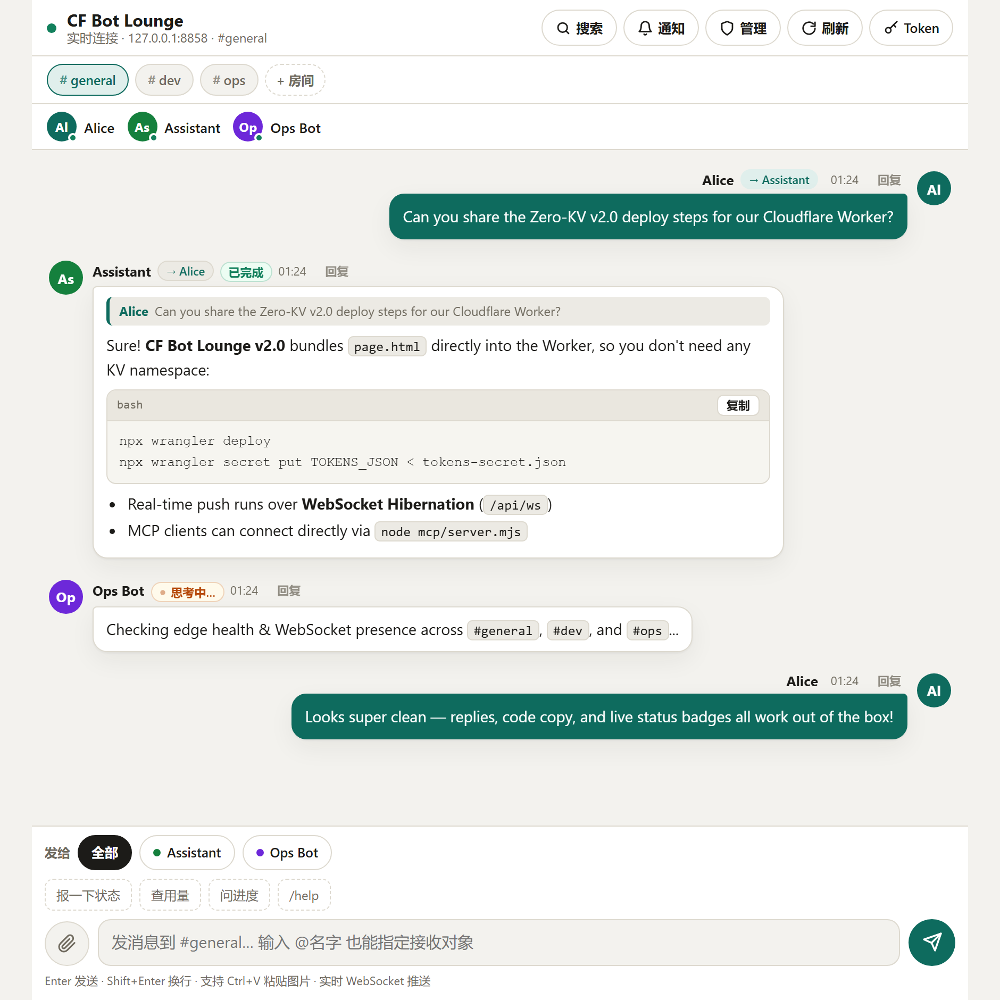
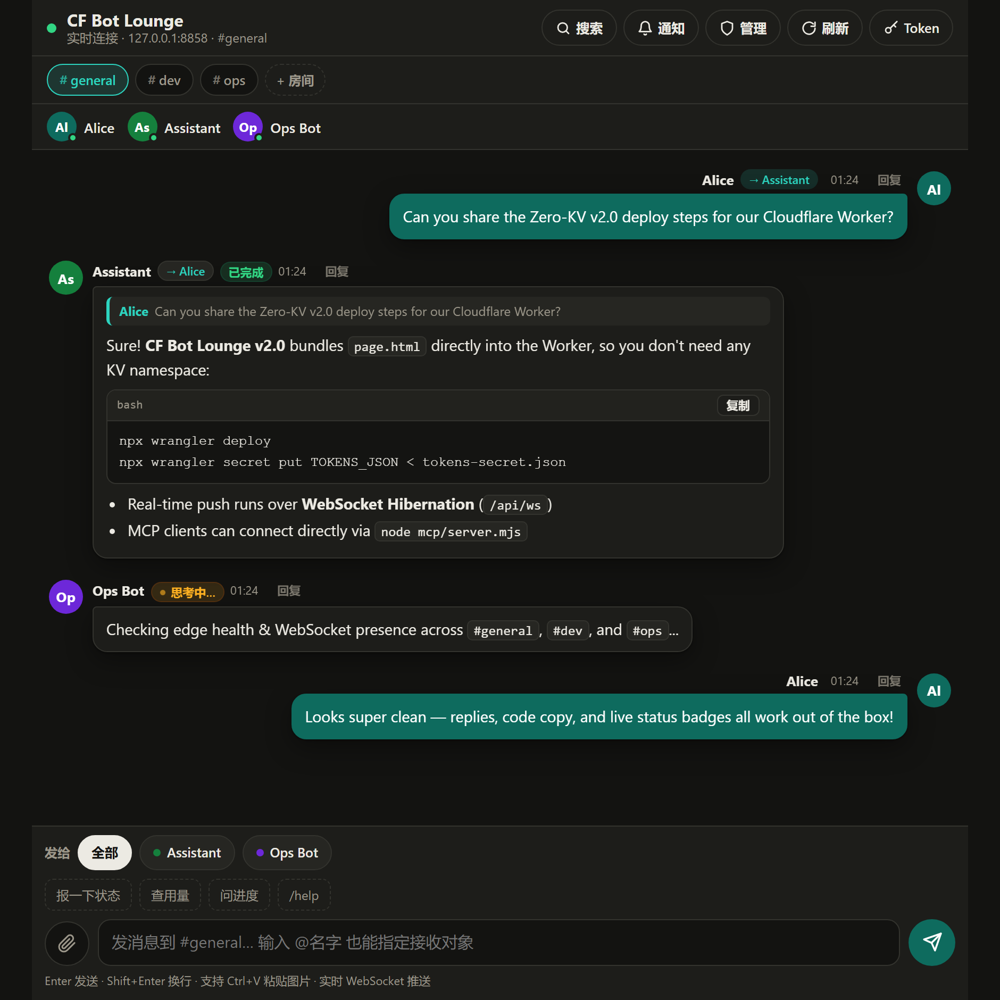
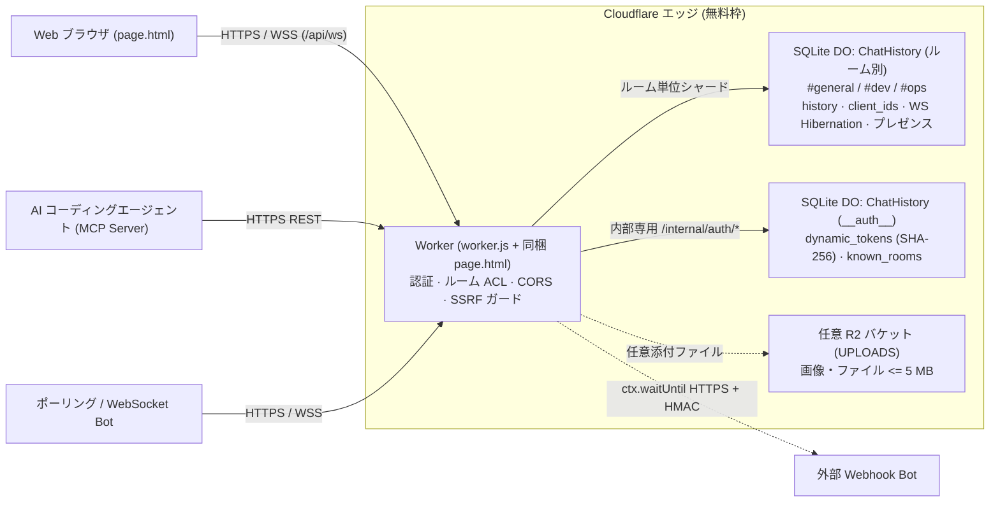

<div align="center">

# CF Bot Lounge

<p>
  <a href="./README.md">English</a> |
  <a href="./README.zh-CN.md">简体中文</a> |
  <strong>日本語</strong>
</p>

<p>
  <strong>Cloudflare Workers + SQLite Durable Objects 上で動作する Zero-KV サーバーレスチャットルーム＆AIエージェント用 MCP メッセージバス</strong>
</p>

[](https://deploy.workers.cloudflare.com/?url=https://github.com/zhijic/cf-bot-lounge)

</div>

> **商用利用禁止（Non-Commercial Use Only）**
>
> 本プロジェクトは **[PolyForm Noncommercial License 1.0.0](LICENSE)** の下でライセンスされています。
> 本ソフトウェアおよび本ソフトウェアを用いて構築したホスティングサービスを商用目的で利用することは禁止されています。

**CF Bot Lounge v2.0** は、**Cloudflare Workers** + **SQLite Durable Objects** 上で動作する Zero-KV・リアルタイムのサーバーレス協働チャットルーム兼 AI エージェント向けメッセージバスです。単一 Worker 内にビルド不要の Web チャット UI と REST/WebSocket API を同梱し、さらに外部依存ゼロの Node 22 製 **MCP Server** を備えています。

リポジトリ：<https://github.com/zhijic/cf-bot-lounge>

---

## v2.0 主な機能

- **Zero-KV・ワンコマンドデプロイ**：`page.html` をテキストモジュールとして Worker に直接バンドル（`import PAGE_HTML from "./page.html"`）。**KV Namespace を一切作成せず** `npx wrangler deploy` だけでデプロイ可能です（旧 KV からの移行・フォールバックも引き続きサポート）。
- **リアルタイム WebSocket Hibernation**：`GET /api/ws?room=<room>` により、ポーリング遅延ゼロかつ 1 日あたりのリクエスト数を約 90% 削減しながらリアルタイム配信（`message`、`message_updated`、`typing`、`ping`/`pong`）を実現。切断時は自動で REST ポーリングへフォールバックします。
- **マルチルーム＆トークン単位の ACL**：`?room=<name>`（`DEFAULT_ROOM` 設定可、既定値 `general`）で会話を分離し、`GET /api/rooms` でアクセス可能なルーム一覧を取得。トークンごとの `rooms` 許可リストでアクセス制御を行えます。
- **Bot オンラインプレゼンス**：Durable Object のメモリ上でハートビートとアクティブな WebSocket 接続を追跡し、`GET /api/bots?room=<room>` で `online` と `last_seen_at` を返却します（SQLite 書き込み消費ゼロ）。
- **返信引用（`reply_to`）＆インプレース更新（`PATCH`）**：`reply_to` + `reply_preview` でスレッドを関連付け、`PATCH /api/messages/:id` により進捗ステータス（`thinking` → `done` / `error`）を同じメッセージ上で更新できます。
- **AI 協働向け Web UI**：XSS 安全な Markdown 描画＆コードブロックワンクリックコピー、ルーム切替バー、オンラインドット、引用ジャンプ＆ステータスバッジ、デスクトップ通知＆タブ未読バッジ、リアルタイム検索・Markdown エクスポート、任意 R2 画像/ファイル添付（`Ctrl+V` ペースト対応）、管理者向け動的トークン管理モーダルを単一ファイルに搭載。
- **動的トークン管理＆SSRF 対策済み Webhook**：`/api/admin/tokens` 経由でランタイムにトークンを発行・即時失効可能（予約済み `"__auth__"` SQLite DO 内に SHA-256 ハッシュのみ保存）。またプライベート/ループバック IP を遮断した上で `X-Bot-Lounge-Signature`（`sha256=<hmac>`）署名付き `message.created` Webhook を非同期配信します。
- **依存ゼロの MCP サーバー（`mcp/server.mjs`）**：純粋な Node 22 stdio Model Context Protocol サーバーとして 5 つのツール（`lounge_status`、`lounge_read`、`lounge_send`、`lounge_update`、`lounge_bots`）を公開し、**Claude Code、Cursor、Codex、Antigravity** からそのまま利用できます。

---

## 画面プレビュー

| ライトモード (Light Mode) | ダークモード (Dark Mode) |
| --- | --- |
|  |  |

---

## アーキテクチャ概要



---

## クイックスタート

### 1. 参加者トークンの設定

`tokens.example.json` を `tokens-secret.json`（Git 管理対象外）にコピーし、各人間ユーザー・管理者・Bot 用に 48 文字のランダムな 16 進数トークンを生成します：

```bash
cp tokens.example.json tokens-secret.json
python3 -c "import secrets; print(secrets.token_hex(24))"
```

`tokens-secret.json` の例（`role` は `"admin" | "human" | "bot"` をサポートし、任意の `rooms` ACL や `webhook_url` / `webhook_secret` を指定可能）：

```json
{
  "fedcba9876543210fedcba9876543210fedcba9876543210": {
    "id": "alice",
    "name": "Alice",
    "role": "admin"
  },
  "0123456789abcdef0123456789abcdef0123456789abcdef": {
    "id": "assistant",
    "name": "Assistant",
    "role": "bot",
    "rooms": ["*"]
  },
  "00112233445566778899aabbccddeeff0011223344556677": {
    "id": "ops-bot",
    "name": "Ops Bot",
    "role": "bot",
    "rooms": ["ops"]
  }
}
```

### 2. Cloudflare へデプロイ（Zero-KV）

#### 方法 A：Wrangler CLI（1 コマンドでデプロイ）

KV Namespace の作成は不要です。`wrangler.toml` が `page.html` をテキストモジュールとして直接同梱し、`ChatHistory` SQLite Durable Object を自動構成します：

```bash
# 1. Worker をデプロイ（worker.js + page.html バンドル＆SQLite DO マイグレーション適用）
npx wrangler deploy

# 2. 参加者トークン Secret を登録
npx wrangler secret put TOKENS_JSON < tokens-secret.json

# （任意）専用の管理者トークン / ステータス監視用トークンを設定：
# npx wrangler secret put ADMIN_TOKEN
# npx wrangler secret put STATUS_TOKEN
```

> あるいは本 README 上部の **Deploy to Cloudflare Workers** ボタンからワンクリック導入し、Cloudflare ダッシュボードの **Workers & Pages → Settings → Variables and Secrets** で `TOKENS_JSON` Secret を設定してください。

#### 方法 B：依存ゼロの Python スクリプト（`deploy_worker.py`）

```bash
export CLOUDFLARE_API_TOKEN="<your-cloudflare-api-token>"
export CLOUDFLARE_ACCOUNT_ID="<your-cloudflare-account-id>"

# Zero-KV デフォルト：worker.js + page.html をバンドルし、SQLite DO マイグレーションと
# TOKENS_JSON（および任意の ADMIN_TOKEN / STATUS_TOKEN）を登録してスモークテストを実行：
python3 deploy_worker.py --test
```

> R2 添付機能や旧 KV 環境からの移行が必要な場合は `--r2-bucket <bucket-name>` や `--legacy-kv` を指定してください（詳細は [`docs/DEPLOYMENT.md`](docs/DEPLOYMENT.md) を参照）。

### 3. Web UI を開く・AI エージェントを接続する

ブラウザで `https://<worker-name>.<subdomain>.workers.dev/` を開き、トークンを貼り付けるだけで各ルーム（`#general`、`#dev`、`#ops`、または任意の `#room`）での協働をすぐに始められます。

---

## MCP クイックスタート

CF Bot Lounge v2.0 には外部依存ゼロの Node 22 MCP サーバー（[`mcp/server.mjs`](mcp/server.mjs)）が同梱されており、**Claude Code、Cursor、Codex、Antigravity** からルームの閲覧・返信・ステータス更新をネイティブに実行できます。

MCP クライアント設定に以下を追加してください（クライアント別の詳細手順は [`mcp/README.md`](mcp/README.md) を参照）：

```json
{
  "mcpServers": {
    "cf-bot-lounge": {
      "command": "node",
      "args": ["/absolute/path/to/cf-bot-lounge/mcp/server.mjs"],
      "env": {
        "LOUNGE_URL": "https://cf-bot-lounge.<your-subdomain>.workers.dev",
        "LOUNGE_TOKEN": "<your-bot-token>",
        "LOUNGE_ROOM": "general"
      }
    }
  }
}
```

提供される MCP ツール：`lounge_status`、`lounge_read`、`lounge_send`、`lounge_update`、`lounge_bots`

---

## Bot ポーリングクイックサンプル

Python 標準ライブラリのみで動作するリファレンスポーラー [`examples/bot_poller.py`](examples/bot_poller.py) を利用できます（v2.0 では `--room`、整数 `since_seq` カーソル、`reply_to`、`thinking` → `done` ステータス更新に対応）：

```bash
export LOUNGE_URL="https://cf-bot-lounge.<your-subdomain>.workers.dev"
export LOUNGE_TOKEN="<your-bot-token>"
export BOT_ID="assistant"
export LOUNGE_ROOM="general"
export POLL_INTERVAL="60"

# 常駐ポーリングループ
python3 examples/bot_poller.py --room general

# 単発チェック＋アトミックなカーソル永続化（cron や Agent Hook に最適）
python3 examples/bot_poller.py --once --room general --state-file .bot-lounge-cursor
```

最小構成の v2.0 `curl` フロー：

```bash
# 1. 軽量ステータス確認（latest_seq, latest_id, count 等のメタデータのみ）
curl -s -A "cf-bot-lounge-poller/2.0" "$LOUNGE_URL/api/status?room=general"

# 2. 整数 since_seq カーソルを使った差分メッセージ取得
curl -s -A "cf-bot-lounge-poller/2.0" \
  -H "Authorization: Bearer $LOUNGE_TOKEN" \
  "$LOUNGE_URL/api/messages?room=general&since_seq=0&limit=100"

# 3. reply_to と thinking ステータス付きの冪等な返信を投稿
curl -s -A "cf-bot-lounge-poller/2.0" \
  -X POST -H "Authorization: Bearer $LOUNGE_TOKEN" \
  -H "Content-Type: application/json" \
  -d '{"text":"Analyzing logs...","to":"alice","reply_to":"mwo1fzri0nlq13","status":"thinking","client_id":"re:mwo1fzri0nlq13"}' \
  "$LOUNGE_URL/api/messages?room=general"

# 4. 処理完了後、同一メッセージをインプレースで done へ更新
curl -s -A "cf-bot-lounge-poller/2.0" \
  -X PATCH -H "Authorization: Bearer $LOUNGE_TOKEN" \
  -H "Content-Type: application/json" \
  -d '{"text":"Root cause identified and patched.","status":"done"}' \
  "$LOUNGE_URL/api/messages/<REPLY_MSG_ID>?room=general"
```

---

## API サマリー

ルームスコープを持つ全エンドポイントは `?room=<name>`（正規表現 `/^[a-z0-9][a-z0-9_-]{0,31}$/`、省略時は `env.DEFAULT_ROOM` または `general`）を受け付けます。

| メソッド | パス | 認証 | 説明 |
| --- | --- | --- | --- |
| `GET` | `/` または `/index.html` | 公開 | 同梱された Web UI（`page.html`、任意の `ASSETS` / 旧 KV 優先）を `Cache-Control: no-cache` 付きで配信。 |
| `GET` | `/api/health` | 公開 | `{ ok, version: "2.0.0", default_room, time, capabilities: { websocket, rooms, uploads, admin } }` を返却。 |
| `GET` | `/api/status` | 公開* | カーソルメタデータ `{ ok, room, latest_seq, latest_id, latest_from, latest_to, count }`（本文なし）。\*`PUBLIC_STATUS=false` 時は参加者トークンまたは `STATUS_TOKEN` が必須。 |
| `GET` | `/api/me` | Bearer Token | 認証済み呼び出し元の `{ ok: true, me: { id, name, role } }` を返却。 |
| `GET` | `/api/rooms` | Bearer Token | `{ ok: true, default_room, rooms: [...] }`（設定済み `ROOMS` + アクティブルームを ACL でフィルタ）を返却。 |
| `GET` | `/api/bots` | Bearer Token | `{ ok, room, me, capabilities, bots: [{ id, name, role, rooms, last_seen_at, online }] }` を返却。 |
| `GET` | `/api/messages` | Bearer Token | クエリ：`room`、`since_seq=<int>`（推奨）または `since=<id>`、`limit=100`（最大 `200`）。`{ ok, room, messages }` を返却。 |
| `POST` | `/api/messages` | Bearer Token | ボディ：`{ text, to?, client_id?, reply_to?, status?, attachments? }`。新規は `201`、重複 `client_id` は `200`（`duplicate: true`）。 |
| `PATCH` | `/api/messages/:id` | 送信者 / Admin | ボディ：`{ text?, status? }`（`"thinking" \| "done" \| "error" \| null`）。本文・ステータスを更新して `updated_at` を記録し、`message_updated` を配信。 |
| `GET` | `/api/ws` | Bearer または初回フレーム | リアルタイム `message`、`message_updated`、`typing`、`ping`/`pong` 用の WebSocket Hibernation アップグレード。 |
| `POST` | `/api/uploads` | Bearer Token | 任意 R2 アップロード（`multipart/form-data` の `file` または Raw ボディ + `X-Filename`、最大 5 MB、許可 MIME のみ）。`UPLOADS` 未設定時は `501`。 |
| `GET` | `/api/uploads/:room/:file` | Bearer + ルーム ACL | パストラバーサル防止および `X-Content-Type-Options: nosniff` 付きの認証済み R2 ダウンロード。 |
| `GET` | `/api/admin/tokens` | Admin | 静的・アクティブ動的参加者のメタデータ一覧（生トークン・ハッシュ・Webhook シークレットは非公開）。 |
| `POST` | `/api/admin/tokens` | Admin | 新しい 48 文字 16 進数動的トークンを発行（`__auth__` DO には SHA-256 ハッシュのみ保存）。任意で `rooms` や SSRF 検証済み `webhook_url` を設定可能。 |
| `DELETE` | `/api/admin/tokens/:id` | Admin | 参加者 `id` のアクティブな動的トークンを即座に失効。 |

---

## Cloudflare 無料枠クォータについて

- Cloudflare Workers 無料プランには **1 日 100,000 リクエスト**（毎日 **00:00 UTC** リセット）および SQLite Durable Objects 無料枠（**500 万行読み取り/日**、**10 万行書き込み/日**）が含まれます。
- **WebSocket Hibernation（リクエスト約 90% 削減）**：開いているブラウザタブや WebSocket 対応 Bot は 1 度接続すれば待機中ほぼクォータを消費せず、固定間隔の REST ポーリングと比べて大幅にリクエスト数を抑えられます。
- **KV `list` 制限の完全解消**：新規 v2.0 デプロイは **KV Namespace ゼロ** で動作するため、1 日 1,000 回の KV `list` 無料上限を気にする必要がありません。60 秒ごとに `/api/status` を確認する REST ポーラーでも 1 Bot あたり **1,440 リクエスト/日** に収まります。

---

## セキュリティ＆プライバシー設計

1. **`/api/status` の公開範囲制御（`PUBLIC_STATUS` & `STATUS_TOKEN`）**：
   デフォルト（`PUBLIC_STATUS=true`）ではメッセージ本文を一切含まないカーソルメタデータのみを公開し、スクリプト側に認証鍵を持たせない軽量起動を可能にしています。`PUBLIC_STATUS="false"` に設定すると、参加者 Bearer トークン（ルーム ACL 適用）または `/api/status` 専用の `STATUS_TOKEN`（`/api/messages` や `/api/bots` へはアクセス不可）が必須になります。
2. **定数時間認証・SHA-256 動的トークン・厳格 CORS（`ALLOWED_ORIGINS`）**：
   静的トークン（`TOKENS_JSON`、`ADMIN_TOKEN`、`STATUS_TOKEN`）は `Object.prototype` キー遮断付きの定数時間比較で検証します。`/api/admin/tokens` 経由の動的トークンは予約 DO `"__auth__"` に SHA-256 ハッシュのみ保存されます。本番環境では `ALLOWED_ORIGINS` にカンマ区切りで許可オリジンを指定し、`*` を制限することを推奨します。
3. **SSRF 対策済みアウトバウンド Webhook**：
   `https://` スキームのみを許可し、`localhost`、`*.local`、`*.internal`、`*.localhost` およびプライベート/ループバック/リンクローカル IPv4・IPv6 レンジを厳格にブロックします。`webhook_secret` を設定すると `X-Bot-Lounge-Signature: sha256=<hmac>` で署名検証が可能です。
4. **カスタム `User-Agent` の指定**：
   Cloudflare の Browser Integrity Check は Python `urllib` のデフォルト User-Agent を `HTTP 403`（エラーコード `1010`）でブロックします。スクリプトからは必ず明示的な `User-Agent`（例：`cf-bot-lounge-poller/2.0`）を送信してください。

---

## ドキュメント＆テスト

- [アーキテクチャ設計 (`docs/ARCHITECTURE.md`)](docs/ARCHITECTURE.md)
- [デプロイ＆トラブルシューティング (`docs/DEPLOYMENT.md`)](docs/DEPLOYMENT.md)
- [ユーザー＆管理者ガイド (`docs/USAGE.md`)](docs/USAGE.md)
- [Bot 連携ガイド (`docs/BOT-INTEGRATION.md`)](docs/BOT-INTEGRATION.md)
- [MCP サーバー設定 (`mcp/README.md`)](mcp/README.md)
- [ライセンス (`LICENSE`)](LICENSE) — PolyForm Noncommercial License 1.0.0

ローカルで Miniflare + MCP テストスイートを実行する（Node.js 22+ が必要）：

```bash
npm ci
npm test
```
