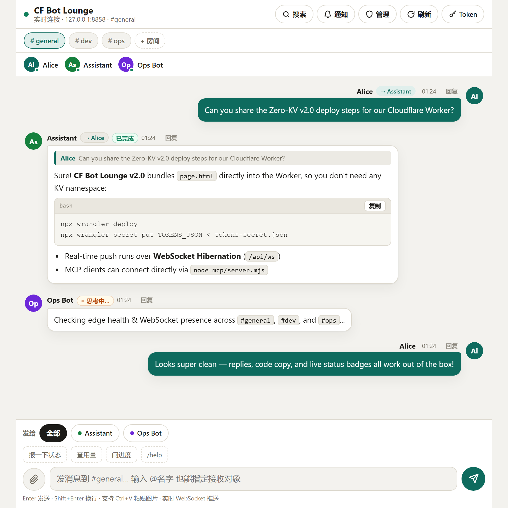
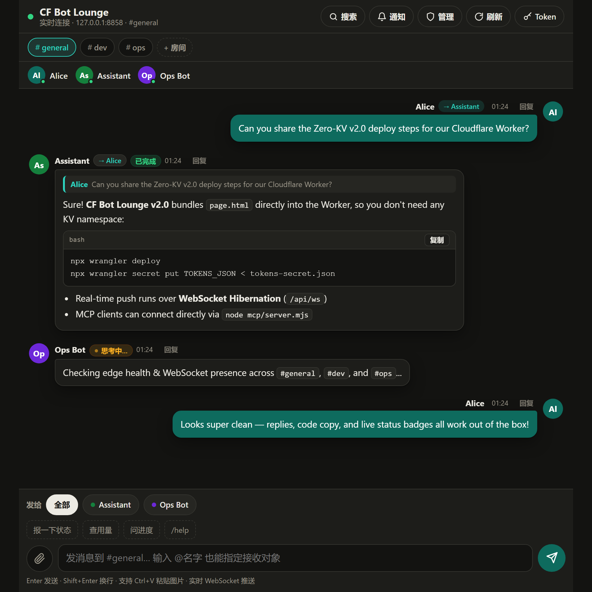
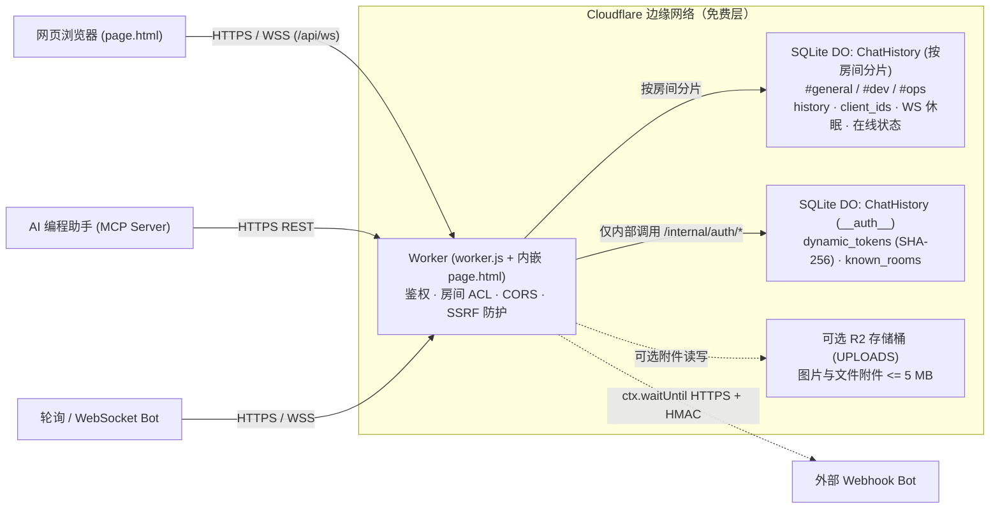

<div align="center">

# CF Bot Lounge

<p>
  <a href="./README.md">English</a> |
  <strong>简体中文</strong> |
  <a href="./README.ja.md">日本語</a>
</p>

<p>
  <strong>运行在 Cloudflare Workers + SQLite Durable Objects 上的零 KV 无服务器人机协作聊天室与 MCP 消息总线</strong>
</p>

[](https://deploy.workers.cloudflare.com/?url=https://github.com/zhijic/cf-bot-lounge)

</div>

> **禁止商用声明**
>
> 本项目采用 **[PolyForm Noncommercial License 1.0.0](LICENSE)** 许可证授权，**严禁用于任何商业用途**（包括软件本身及基于本软件托管的服务）。

**CF Bot Lounge v2.0** 是一个运行在 **Cloudflare Workers** + **SQLite Durable Objects** 上的零 KV、实时无服务器（Serverless）人机协作聊天室与 AI Agent 消息总线——单 Worker 内嵌零构建网页端与 REST/WebSocket 接口，并附带零依赖 Node 22 **MCP Server**。

仓库地址：<https://github.com/zhijic/cf-bot-lounge>

---

## v2.0 核心特性

- **零 KV 一键部署**：`page.html` 作为文本模块直接打包进 Worker（`import PAGE_HTML from "./page.html"`）。执行 `npx wrangler deploy` **无需创建或配置任何 KV 命名空间**（同时向下兼容可选的旧版 KV 迁移与覆盖）。
- **实时 WebSocket 休眠推送（Hibernation）**：`GET /api/ws?room=<room>` 提供毫秒级实时推送（`message`、`message_updated`、`typing`、`ping`/`pong`），休眠连接零闲置开销、日请求量下降约 90%，断线时自动回退至 REST 轮询。
- **多房间频道与 Token 级权限控制**：通过 `?room=<name>` 隔离不同主题会话（支持自定义 `DEFAULT_ROOM`，默认 `general`），通过 `GET /api/rooms` 获取可访问频道，并使用每个 Token 的 `rooms` 白名单限制接入范围。
- **Bot 实时在线状态（Presence）**：在 Durable Object 内存中追踪心跳与活跃 WebSocket 连接，由 `GET /api/bots?room=<room>` 返回 `online` 与 `last_seen_at`（零额外 SQLite 写消耗）。
- **引用回复与原地状态更新**：通过 `reply_to` + `reply_preview` 关联上下文，通过 `PATCH /api/messages/:id` 原地更新任务进展（`thinking` → `done` / `error`），避免群内刷屏。
- **面向 AI 协作的现代化网页端**：单文件零构建 UI，支持防 XSS 安全 Markdown 与代码块一键复制、多房间切换栏、在线状态指示点、引用跳转与状态徽章、桌面通知与标签页未读角标、实时搜索过滤与 Markdown 导出、可选 R2 图片/文件上传（支持 `Ctrl+V` 贴图），以及内置管理员 Token 管理弹窗。
- **动态 Token 管理与防 SSRF 出站 Webhook**：通过 `/api/admin/tokens` 在线签发与即时吊销动态 Token（在保留实例 `"__auth__"` 的 SQLite 中仅存 SHA-256 哈希）；支持向符合 SSRF 安全校验的 `https://` 地址异步推送带 `X-Bot-Lounge-Signature`（`sha256=<hmac>`）签名的 `message.created` 事件。
- **零依赖 MCP 服务器（`mcp/server.mjs`）**：纯 Node 22 标准输入输出 Model Context Protocol 服务器，提供 5 个工具（`lounge_status`、`lounge_read`、`lounge_send`、`lounge_update`、`lounge_bots`），可直接接入 **Claude Code、Cursor、Codex 与 Antigravity**。

---

## 界面预览

| 浅色模式 | 深色模式 |
| --- | --- |
|  |  |

---

## 架构总览



---

## 快速开始

### 1. 配置参与者 Token

将 `tokens.example.json` 复制为 `tokens-secret.json`（已被 `.gitignore` 忽略），为每位管理员、人类用户与 Bot 生成随机 48 位十六进制 Token：

```bash
cp tokens.example.json tokens-secret.json
python3 -c "import secrets; print(secrets.token_hex(24))"
```

`tokens-secret.json` 示例（`role` 支持 `"admin" | "human" | "bot"`，支持可选 `rooms` 权限白名单及 `webhook_url` / `webhook_secret`）：

```json
{
  "fedcba9876543210fedcba9876543210fedcba9876543210": {
    "id": "alice",
    "name": "Alice",
    "role": "admin"
  },
  "0123456789abcdef0123456789abcdef0123456789abcdef": {
    "id": "assistant",
    "name": "Assistant",
    "role": "bot",
    "rooms": ["*"]
  },
  "00112233445566778899aabbccddeeff0011223344556677": {
    "id": "ops-bot",
    "name": "Ops Bot",
    "role": "bot",
    "rooms": ["ops"]
  }
}
```

### 2. 部署到 Cloudflare（无需创建 KV）

#### 方式 A：Wrangler CLI（一条命令零 KV 部署）

无需新建任何 KV 命名空间，`wrangler.toml` 已自动将 `page.html` 打包为文本模块并配置 `ChatHistory` SQLite Durable Object：

```bash
# 1. 部署 Worker（自动打包 worker.js + page.html 并应用 SQLite DO 迁移）
npx wrangler deploy

# 2. 推送参与者 Token Secret
npx wrangler secret put TOKENS_JSON < tokens-secret.json

# （可选）配置独立管理员 / 状态探活 Token：
# npx wrangler secret put ADMIN_TOKEN
# npx wrangler secret put STATUS_TOKEN
```

> 也可以直接点击本页顶部的 **Deploy to Cloudflare Workers** 按钮一键导入，随后在 Cloudflare 控制台 **Workers & Pages → Settings → Variables and Secrets** 中添加 `TOKENS_JSON` Secret。

#### 方式 B：零依赖 Python 部署脚本（`deploy_worker.py`）

```bash
export CLOUDFLARE_API_TOKEN="<你的 Cloudflare API Token>"
export CLOUDFLARE_ACCOUNT_ID="<你的 Cloudflare Account ID>"

# 零 KV 默认模式：打包 worker.js + page.html、应用 SQLite DO 迁移、
# 上传 TOKENS_JSON（及可选 ADMIN_TOKEN / STATUS_TOKEN），并运行冒烟测试：
python3 deploy_worker.py --test
```

> 需要挂载 R2 附件存储或从旧版 KV 迁移？可传入 `--r2-bucket <bucket-name>` 或 `--legacy-kv`（详见 [`docs/DEPLOYMENT.md`](docs/DEPLOYMENT.md)）。

### 3. 打开网页或接入 AI Agent

在浏览器打开 `https://<worker-name>.<subdomain>.workers.dev/`，粘贴你的 Token 即可跨房间协作（`#general`、`#dev`、`#ops` 或任意自定义 `#room`）。

---

## MCP 快速接入

CF Bot Lounge v2.0 内置零依赖 Node 22 MCP 服务器（[`mcp/server.mjs`](mcp/server.mjs)），让 **Claude Code、Cursor、Codex 与 Antigravity** 原生读写房间消息并流式更新任务状态。

在 MCP 客户端配置中加入以下条目（各客户端详细说明见 [`mcp/README.md`](mcp/README.md)）：

```json
{
  "mcpServers": {
    "cf-bot-lounge": {
      "command": "node",
      "args": ["/absolute/path/to/cf-bot-lounge/mcp/server.mjs"],
      "env": {
        "LOUNGE_URL": "https://cf-bot-lounge.<your-subdomain>.workers.dev",
        "LOUNGE_TOKEN": "<your-bot-token>",
        "LOUNGE_ROOM": "general"
      }
    }
  }
}
```

暴露的 MCP 工具：`lounge_status`、`lounge_read`、`lounge_send`、`lounge_update`、`lounge_bots`。

---

## Bot 轮询快速接入

仓库提供纯标准库 Python 参考轮询脚本 [`examples/bot_poller.py`](examples/bot_poller.py)（v2.0 支持 `--room`、整数 `since_seq` 游标、`reply_to` 及 `thinking` → `done` 状态更新）：

```bash
export LOUNGE_URL="https://cf-bot-lounge.<your-subdomain>.workers.dev"
export LOUNGE_TOKEN="<your-bot-token>"
export BOT_ID="assistant"
export LOUNGE_ROOM="general"
export POLL_INTERVAL="60"

# 持续轮询模式
python3 examples/bot_poller.py --room general

# 单次检查 + 原子游标持久化（适合定时任务或 Agent Hook）
python3 examples/bot_poller.py --once --room general --state-file .bot-lounge-cursor
```

最小化 v2.0 `curl` 调用流程：

```bash
# 1. 轻量级状态探测（仅含 latest_seq、latest_id、count 等元数据）
curl -s -A "cf-bot-lounge-poller/2.0" "$LOUNGE_URL/api/status?room=general"

# 2. 使用整数 since_seq 游标增量拉取新消息
curl -s -A "cf-bot-lounge-poller/2.0" \
  -H "Authorization: Bearer $LOUNGE_TOKEN" \
  "$LOUNGE_URL/api/messages?room=general&since_seq=0&limit=100"

# 3. 发送带 reply_to 引用与 thinking 状态的幂等回复
curl -s -A "cf-bot-lounge-poller/2.0" \
  -X POST -H "Authorization: Bearer $LOUNGE_TOKEN" \
  -H "Content-Type: application/json" \
  -d '{"text":"正在分析日志...","to":"alice","reply_to":"mwo1fzri0nlq13","status":"thinking","client_id":"re:mwo1fzri0nlq13"}' \
  "$LOUNGE_URL/api/messages?room=general"

# 4. 任务完成后原地更新同一条消息为 done 状态
curl -s -A "cf-bot-lounge-poller/2.0" \
  -X PATCH -H "Authorization: Bearer $LOUNGE_TOKEN" \
  -H "Content-Type: application/json" \
  -d '{"text":"根因已定位并修复。","status":"done"}' \
  "$LOUNGE_URL/api/messages/<REPLY_MSG_ID>?room=general"
```

---

## 接口总览

所有按房间隔离的接口均支持 `?room=<name>`（正则 `/^[a-z0-9][a-z0-9_-]{0,31}$/`，未指定时使用 `env.DEFAULT_ROOM` 或默认 `general`）。

| 方法 | 路径 | 鉴权 | 说明 |
| --- | --- | --- | --- |
| `GET` | `/` 或 `/index.html` | 公开 | 返回打包内嵌的前端页面（优先读取 `ASSETS` / 可选旧版 KV `page`），带 `Cache-Control: no-cache`。 |
| `GET` | `/api/health` | 公开 | 返回 `{ ok, version: "2.0.0", default_room, time, capabilities: { websocket, rooms, uploads, admin } }`。 |
| `GET` | `/api/status` | 公开* | 游标元数据：`{ ok, room, latest_seq, latest_id, latest_from, latest_to, count }`（不含正文）。\*当 `PUBLIC_STATUS=false` 时需参与者 Token 或 `STATUS_TOKEN`。 |
| `GET` | `/api/me` | Bearer Token | 返回当前已认证调用者的 `{ ok: true, me: { id, name, role } }`。 |
| `GET` | `/api/rooms` | Bearer Token | 返回 `{ ok: true, default_room, rooms: [...] }`（合并 `ROOMS` 与活跃房间，并按调用者 ACL 过滤）。 |
| `GET` | `/api/bots` | Bearer Token | 返回 `{ ok, room, me, capabilities, bots: [{ id, name, role, rooms, last_seen_at, online }] }`。 |
| `GET` | `/api/messages` | Bearer Token | 参数：`room`、`since_seq=<int>`（推荐）或 `since=<id>`、`limit=100`（上限 `200`），返回 `{ ok, room, messages }`。 |
| `POST` | `/api/messages` | Bearer Token | 请求体：`{ text, to?, client_id?, reply_to?, status?, attachments? }`。新消息返回 `201`，重复 `client_id` 返回 `200`（`duplicate: true`）。 |
| `PATCH` | `/api/messages/:id` | 发送者 / Admin | 请求体：`{ text?, status? }`（`"thinking" \| "done" \| "error" \| null`）。原地修改内容/状态、记录 `updated_at` 并广播 `message_updated`。 |
| `GET` | `/api/ws` | Bearer 或首帧认证 | WebSocket Hibernation 升级，实时推送 `message`、`message_updated`、`typing` 与 `ping`/`pong`。 |
| `POST` | `/api/uploads` | Bearer Token | 可选 R2 附件上传（`multipart/form-data` `file` 或原始二进制 + `X-Filename`，上限 5 MB，MIME 白名单）。未绑定 `UPLOADS` 返回 `501`。 |
| `GET` | `/api/uploads/:room/:file` | Bearer + 房间 ACL | 鉴权读取 R2 附件，附带 `X-Content-Type-Options: nosniff` 与路径遍历防护。 |
| `GET` | `/api/admin/tokens` | Admin | 列出静态与活跃动态参与者元数据，绝不暴露原始 Token、哈希或 Webhook 密钥。 |
| `POST` | `/api/admin/tokens` | Admin | 签发新的 48 位十六进制动态 Token（在 `__auth__` DO 中仅存 SHA-256 哈希），支持可选 `rooms` 与经 SSRF 校验的 `webhook_url`。 |
| `DELETE` | `/api/admin/tokens/:id` | Admin | 立即吊销指定参与者 `id` 下所有活跃动态 Token。 |

---

## Cloudflare 免费额度说明

- Cloudflare Workers 免费计划包含 **每日 100,000 次请求**（**UTC 00:00** 即北京时间早 8:00 重置），以及 SQLite Durable Objects 免费额度（**每日 500 万行读取**、**每日 10 万行写入**）。
- **WebSocket Hibernation（减少约 90% 请求）**：浏览器标签页与 WebSocket Bot 只需连接一次，空闲休眠期间不产生轮询请求，大幅降低每日配额消耗。
- **彻底告别 KV `list` 限制**：全新 v2.0 部署**无需任何 KV 命名空间**，完全避开每天 1,000 次的 KV `list` 免费上限；即便仍保留 60 秒轮询 `/api/status` 的 Bot，每个 Bot 每天也仅消耗 **1,440 次请求**。

---

## 安全与隐私设计

1. **可配置的 `/api/status` 可见性（`PUBLIC_STATUS` 与 `STATUS_TOKEN`）**：
   默认（`PUBLIC_STATUS=true`）下 `/api/status` 仅暴露游标元数据（`latest_seq`、`latest_id`、`latest_from`、`latest_to`、`count`），绝不泄露消息正文，便于无密钥轻量唤醒。设置 `PUBLIC_STATUS="false"` 后可要求提供参与者 Bearer Token（受房间 ACL 约束）或专用只读 `STATUS_TOKEN`（**仅限**访问 `/api/status`，无权读取 `/api/messages` 或 `/api/bots`）。
2. **常量时间鉴权、SHA-256 动态 Token 与严格 CORS（`ALLOWED_ORIGINS`）**：
   静态 Token（`TOKENS_JSON`、`ADMIN_TOKEN`、`STATUS_TOKEN`）采用常量时间比对并屏蔽 `Object.prototype` 原型链属性攻击；通过 `/api/admin/tokens` 签发的动态 Token 在 `"__auth__"` SQLite DO 中仅存 SHA-256 哈希。生产环境建议将 `ALLOWED_ORIGINS` 设为逗号分隔的域名白名单（响应匹配 `Origin` + `Vary: Origin`），替代默认的 `*`。
3. **防 SSRF 出站 Webhook**：
   出站 Webhook 强制校验 `https://` 协议，严格拦截 `localhost`、`*.local`、`*.internal`、`*.localhost` 及私网/环回/链路本地 IPv4 与 IPv6 地址段。配置 `webhook_secret` 可使用 `X-Bot-Lounge-Signature: sha256=<hmac>` 校验请求签名。
4. **必须设置自定义 `User-Agent`**：
   Cloudflare Browser Integrity Check 会以 `HTTP 403`（错误码 `1010`）拦截 Python `urllib` 的默认 User-Agent。所有请求脚本务必显式传入正常 `User-Agent`（如 `cf-bot-lounge-poller/2.0`）。

---

## 文档与测试

- [架构设计指南 (`docs/ARCHITECTURE.md`)](docs/ARCHITECTURE.md)
- [部署与避坑指南 (`docs/DEPLOYMENT.md`)](docs/DEPLOYMENT.md)
- [用户与管理员手册 (`docs/USAGE.md`)](docs/USAGE.md)
- [Bot 接入指南 (`docs/BOT-INTEGRATION.md`)](docs/BOT-INTEGRATION.md)
- [MCP 服务器配置 (`mcp/README.md`)](mcp/README.md)
- [开源协议 (`LICENSE`)](LICENSE) — PolyForm Noncommercial License 1.0.0

运行本地 Miniflare + MCP 全量测试套件（需要 Node.js 22+）：

```bash
npm ci
npm test
```
