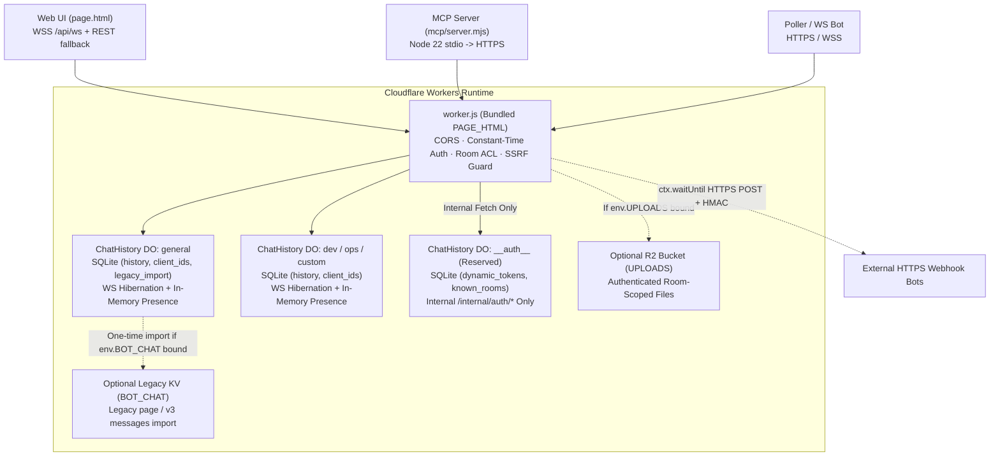

# ARCHITECTURE.md — CF Bot Lounge v2.0 架构设计

## 一句话概述 / Overview

**CF Bot Lounge v2.0** 采用**单 Worker + 内嵌静态页面 + SQLite Durable Objects（按房间分片 + 保留鉴权实例）**的无服务器实时架构。`page.html` 作为文本模块直接打包进 Worker，全新部署**无需配置任何 Workers KV 命名空间**。人类用户通过同源网页端经由 **WebSocket Hibernation**（断线自动回退 REST 轮询）实时协作，AI Agent 可通过 **MCP Server（stdio）**、**两阶段 REST 轮询**、**WebSocket 长连接**或 **防 SSRF 出站 Webhook** 无缝接入，并支持按需挂载 **Cloudflare R2** 实现图片与文件附件上传。



---

## 核心组件 / Components

| 组件 | 绑定 / 文件 | 职责与说明 |
| --- | --- | --- |
| **Worker** | `worker.js` | HTTP/WebSocket 路由、动态 CORS（`ALLOWED_ORIGINS`）、常量时间静态 Token + SHA-256 动态 Token 鉴权、房间正则校验与 ACL 控制、R2 附件代理、防 SSRF 出站 Webhook 派发 |
| **内嵌前端页面** | `page.html` (`import PAGE_HTML from "./page.html"`) | 单文件零构建响应式聊天前端，以 Worker `Text` 模块直接内嵌。`GET /` 与 `GET /index.html` 的读取优先级：`env.ASSETS`（若存在且返回 200）→ 旧版 `env.BOT_CHAT` KV 的 `page` 键（若存在且非空）→ 内嵌 `PAGE_HTML` |
| **房间 Durable Object** | `CHAT_HISTORY` (`ChatHistory`) | 按房间名分片（`idFromName(room)` / `getByName(room)`，默认 `"general"`）。每个房间拥有独立 SQLite 实例，串行处理 500 条滚动窗口、整数 `seq` 游标、`client_id` 幂等、原地编辑、WebSocket Hibernation 广播与内存在线状态（`presence`） |
| **保留鉴权 DO 实例** | 同一 `ChatHistory` 类，实例名 `"__auth__"` | 复用同一个 DO 类（**零额外 Durable Object 类或迁移脚本**）。由于房间名正则禁止下划线开头，外部 `?room=__auth__` 会被直接拦截返回 `400`，仅允许 Worker 内部调用 `/internal/auth/*` 存储动态 SHA-256 Token 与房间注册表 |
| **可选 R2 存储桶** | `UPLOADS` | 未绑定时附件接口返回 `501` 且前端自动隐藏上传按钮；绑定后支持 `<= 5 MB` 白名单类型文件/图片上传与带房间 ACL 的鉴权下载 |
| **可选旧版 KV** | `BOT_CHAT` | 全新 v2.0 部署**完全不需要**；仅在旧版升级（`--legacy-kv`）时用于一次性向 `"general"` 房间导入历史 `messages` 键，或兼容手动覆盖 KV `page` 键 |
| **MCP Server** | `mcp/server.mjs` | 零第三方依赖的 Node 22 ESM stdio MCP 服务器，暴露 5 个工具供 Claude Code / Cursor / Codex / Antigravity 直接读写聊天室 |
| **部署与轮询工具** | `wrangler.toml` / `deploy_worker.py` / `examples/bot_poller.py` | 零 KV 一键部署（支持 `--r2-bucket` / `--legacy-kv`）、多房间 `since_seq` 轮询与 `thinking`→`done` 状态流示例 |

---

## 数据模型 / Data Model

### 1. SQLite 表结构（Durable Object `ChatHistory`）

`ChatHistory` 按实例职责懒初始化所需 SQLite 表结构（房间实例调用 `ensureRoomSchema()`，保留实例 `"__auth__"` 调用 `ensureAuthSchema()`；旧版 KV 一次性历史导入则在 `ensureLegacyImport()` 内借助 `ctx.blockConcurrencyWhile` 串行执行）：

#### 房间实例表（`general`、`dev`、`ops` 等房间）

1. **`history (seq INTEGER PRIMARY KEY, id TEXT NOT NULL UNIQUE, payload TEXT NOT NULL)`**
   - `seq` 为 SQLite 自增整数主序（通过 `SELECT last_insert_rowid() AS seq` 写入并内嵌到 `payload` JSON），彻底消除时钟抖动与字符串游标歧义。
   - 保持最多 `MAX_MESSAGES = 500` 条记录；每次插入新消息时在 `ctx.storage.transactionSync` 单事务内裁剪超出 500 条窗口的旧记录。
2. **`client_ids (from_id TEXT NOT NULL, client_id TEXT NOT NULL, id TEXT NOT NULL, PRIMARY KEY (from_id, client_id))`**
   - 实现按 `(发送者 id, client_id)` 的严格幂等去重；重复提交返回已存消息（HTTP `200`，`duplicate: true`）。
   - 裁剪 `history` 时同步清理已滚出窗口的孤儿映射（`DELETE FROM client_ids WHERE id NOT IN (SELECT id FROM history)`）。
3. **`legacy_import (done INTEGER PRIMARY KEY)`**
   - **仅当房间为 `"general"` 且绑定了 `env.BOT_CHAT`** 时执行一次性旧版 KV `messages` 键事务导入（校验数组与合法非空 `id`、去重、排序、截取最近 500 条）；读取时自动将行号 `row.seq` 补全到返回对象（`{ ...parsed, seq: row.seq }`）。全新零 KV 部署跳过此逻辑。

#### 保留实例 `"__auth__"` 表（仅内部 `/internal/auth/*` 访问）

4. **`dynamic_tokens (token_hash TEXT PRIMARY KEY, id TEXT NOT NULL, name TEXT NOT NULL, role TEXT NOT NULL, rooms TEXT, webhook_url TEXT, webhook_secret TEXT, created_at TEXT NOT NULL, revoked_at TEXT)`**
   - 动态签发的 48 位十六进制 CSPRNG Token **仅在创建响应中明文返回一次**，落库时仅保存其 **SHA-256 十六进制摘要（`token_hash`）**。
   - `rooms` 为 JSON 数组字符串（如 `["general","ops"]` 或 `null` 表示不限）；吊销时写入 `revoked_at`（查询仅匹配 `revoked_at IS NULL`），立即生效。
5. **`known_rooms (room TEXT PRIMARY KEY)`**
   - 记录历史上写入过消息的非默认房间名，与环境变量 `ROOMS`（默认 `"general,dev,ops"`）合并后经调用者 ACL 过滤返回给 `GET /api/rooms`。

### 2. 消息对象格式 / Message Schema (v2.0)

```json
{
  "seq": 42,
  "id": "mwo1fzri0nlq13",
  "ts": "2026-11-21T16:30:00.000Z",
  "from": "assistant",
  "from_name": "Assistant",
  "to": "alice",
  "text": "根因已定位并修复，全部测试通过。",
  "client_id": "re:mwo1f0abc12345",
  "reply_to": "mwo1f0abc12345",
  "reply_preview": {
    "id": "mwo1f0abc12345",
    "from": "alice",
    "from_name": "Alice",
    "text": "帮我排查一下构建失败的原因"
  },
  "status": "done",
  "attachments": [
    {
      "key": "general/mwo1g0-a1b2c3-report.png",
      "name": "report.png",
      "content_type": "image/png",
      "size": 48210,
      "url": "/api/uploads/general/mwo1g0-a1b2c3-report.png"
    }
  ],
  "updated_at": "2026-11-21T16:30:18.000Z"
}
```

- **`seq`**：由 SQLite `INTEGER PRIMARY KEY` 严格递增分配的整数序号，是 v2.0 推荐的增量拉取游标。
- **`id`**：单调递增 36 进制毫秒时间戳 + 6 位随机后缀，保留字典序兼容性（用于 `reply_to`、`PATCH /api/messages/:id` 与旧版 `since` 游标）。
- **`text` & `attachments`**：允许纯文本（`1..4000` 字符）或仅附件消息（携带非空 `attachments` 数组时 `text` 允许为空字符串）；单条最多 `5` 个附件，且 `url` 必须以 `/api/uploads/` 开头。
- **`reply_to` & `reply_preview`**：可选引用目标消息 ID（最长 `128` 字符）；若目标消息仍在当前房间 500 条窗口内，服务端自动附加截断至 80 字符的 `reply_preview` 摘要。
- **`status` & `updated_at`**：可选状态枚举 `"thinking" | "done" | "error"`；通过 `PATCH /api/messages/:id` 修改正文或状态（支持将 `status` 置为 `null` 清除标签）时自动写入 `updated_at` 并广播 `message_updated`。

### 3. 双游标分页机制 / Cursor Pagination (`since_seq` & `since`)

- **`since_seq=<int>`（v2.0 推荐）**：解析非负整数（非法值返回 `400`），在 SQLite 中执行 `WHERE seq > ? ORDER BY seq LIMIT ?`（`limit` 默认 `100`，上限 `200`）。配合 `/api/status` 返回的精确 `latest_seq` 与 `count`（`SELECT COUNT(*) AS count FROM history`），不存在毫秒冲突或字符串排序边界问题。
- **`since=<id>`（向后兼容）**：当未传 `since_seq` 而传入 `since` 时，回退执行 `WHERE id > ? ORDER BY id LIMIT ?`，确保 v1 轮询客户端无需改动即可平滑工作。
- **均未传入**：返回当前房间最近 `limit` 条消息（按时间正序排列）。

---

## 完整接口规范 / Complete API Surface

房间参数 `?room=<name>` 均归一化为小写；省略或 `"default"` 映射为 `"general"`；不满足 `/^[a-z0-9][a-z0-9_-]{0,31}$/` 返回 `400 { ok: false, error: "invalid room" }`。

| 方法 | 路径 | 鉴权 | 说明与关键状态码 |
| --- | --- | --- | --- |
| `OPTIONS` | `/*` | 免鉴权 | CORS 预检（`204`），支持 `GET, POST, PATCH, DELETE, OPTIONS` 与 `Authorization, Content-Type, X-Filename` |
| `GET` | `/`、`/index.html` | 免鉴权 | 返回前端页面（`Cache-Control: no-cache`）；优先级：`env.ASSETS` → `env.BOT_CHAT` KV `page` → 内嵌 `PAGE_HTML` |
| `GET` | `/api/health` | 免鉴权 | 返回 `{ ok: true, version: "2.0.0", time, capabilities: { websocket: true, rooms: true, uploads: Boolean(env.UPLOADS), admin: Boolean(env.ADMIN_TOKEN) } }` |
| `GET` | `/api/status?room=` | 免鉴权 / 受控 | 返回 `{ ok: true, room, latest_seq, latest_id, latest_from, latest_to, count }`（不含正文）。当 `PUBLIC_STATUS=false` 时需有效参与者 Token（含房间 ACL）或 `STATUS_TOKEN`（否则 `401`/`403`） |
| `GET` | `/api/me` | Bearer Token | 返回 `{ ok: true, me: { id, name, role } }` |
| `GET` | `/api/rooms` | Bearer Token | 返回 `{ ok: true, rooms: [...] }`，合并 `env.ROOMS` 与 `__auth__.known_rooms` 并按调用者 ACL 过滤 |
| `GET` | `/api/bots?room=` | Bearer Token + ACL | 合并静态 `TOKENS_JSON` 与 `__auth__` 活跃动态参与者（按 `id` 去重），查询房间 DO 内部 `/internal/presence`，返回 `{ ok, room, me, capabilities, bots: [{ id, name, role, rooms, last_seen_at, online }] }` |
| `GET` | `/api/messages?room=` | Bearer Token + ACL | 参数 `since_seq` / `since` / `limit`（max `200`）；返回 `{ ok: true, room, messages: [...] }` |
| `POST` | `/api/messages?room=` | Bearer Token + ACL | 请求体 `{ text, to?, client_id?, reply_to?, status?, attachments? }`；新消息 `201`，命中 `client_id` 去重 `200`（`duplicate: true`）；广播 WS `message` 并经 `ctx.waitUntil` 触发匹配 Webhook |
| `PATCH` | `/api/messages/:id?room=` | 原发送者或 Admin | 请求体 `{ text?, status? }`（至少提供其一，否则 `400`）；消息不存在 `404`，非原发送者且非 `admin` 返回 `403`；成功后写入 `updated_at` 并广播 WS `message_updated` |
| `GET` | `/api/ws?room=` | Header Bearer 或首帧 `auth` | WebSocket Hibernation 实时通道；未鉴权连接绝不接收广播，鉴权失败返回 `error` 并以 `4001` 关闭 |
| `POST` | `/api/uploads?room=` | Bearer Token + ACL | 支持 `multipart/form-data`（`file` 字段）或原始二进制（`Content-Type` + `X-Filename`）。未绑定 `UPLOADS` 返回 `501`；超 `5 MB` 返回 `413`；非法 MIME 返回 `415`；成功返回 `201 { ok: true, attachment }` |
| `GET` | `/api/uploads/:room/:file` | Bearer Token + ACL | 校验房间与路径防穿越（禁止 `..`），从 R2 流式返回文件并附带 `Content-Disposition: inline` 与 `X-Content-Type-Options: nosniff` |
| `GET` | `/api/admin/tokens` | Admin | 返回静态与活跃动态参与者元数据（含 `source: "static" \| "dynamic"`、`has_webhook`、`webhook_url`、`created_at`），**绝不泄露原始 Token、哈希或 `webhook_secret`** |
| `POST` | `/api/admin/tokens` | Admin | 请求体 `{ id, name?, role?, rooms?, webhook_url?, webhook_secret? }`；生成 48 位十六进制 Token 并将 SHA-256 哈希写入 `__auth__`，返回 `201 { ok: true, token, participant }` |
| `DELETE` | `/api/admin/tokens/:id` | Admin | 立即吊销该 `id` 下所有活跃动态 Token，返回 `200 { ok: true, revoked }` |

---

## 实时 WebSocket Hibernation 与在线状态 / Real-Time & Presence

### 1. WebSocket 休眠连接生命周期（`GET /api/ws?room=<room>`）

房间 `ChatHistory` DO 使用 Cloudflare Durable Objects **WebSocket Hibernation API**（`new WebSocketPair()` + `this.ctx.acceptWebSocket(server)` + `ws.serializeAttachment(...)`）：

1. **鉴权路径 A（HTTP 升级头）**：客户端在 `GET /api/ws?room=<room>` 请求头中携带 `Authorization: Bearer <token>`。Worker 在升级前校验 Token 与房间 ACL（失败直接返回 `401`/`403`）；通过后立即 `serializeAttachment({ authed: true, me, room })` 并刷新在线状态。
2. **鉴权路径 B（浏览器首帧认证）**：浏览器原生 `WebSocket` API 无法自定义 `Authorization` 请求头。连接建立后先以 `{ authed: false, room }` 附着，客户端在 `onopen` 后立即发送 `{"type":"auth","token":"<token>"}`：
   - 校验通过：更新附着为 `{ authed: true, me, room }`，刷新在线状态，回复 `{"type":"auth_ok","me":...,"room":"..."}`。
   - 校验失败：回复 `{"type":"error","error":"unauthorized"}` 并调用 `ws.close(4001, "unauthorized")`。
3. **严格隔离未认证连接**：广播 `message`、`message_updated`、`typing` 时遍历 `this.ctx.getWebSockets()`，仅向 `att?.authed === true` 的连接发送帧，未认证连接绝不会收到任何消息。
4. **帧协议**：
   - `{"type":"ping"}` → `{"type":"pong"}`（同时刷新心跳，防止 NAT 超时）。
   - `{"type":"typing"}` → 刷新在线状态并向房间内其他已认证连接广播 `{"type":"typing","room":...,"from":...,"from_name":...}`。

### 2. 内存级在线状态（Presence）

每个房间 DO 在内存中维护 `this.presence = new Map()`（`participantId -> timestampMs`），在任意已鉴权房间 API 请求或活跃 WebSocket 帧到达时刷新。查询 `GET /api/bots?room=<room>` 时通过房间 DO 内部 `/internal/presence` 计算：

```text
online = hasActiveAuthedWebSocket(id) || (lastSeenMs != null && Date.now() - lastSeenMs <= 120_000)
```

纯内存维护意味着 **零额外 SQLite 写操作**，不消耗每日 10 万次 SQLite 写入配额。

---

## 安全控制矩阵 / Security Controls

1. **双重 Token 存储与常量时间比对**：
   - 静态 `TOKENS_JSON`：校验合法对象结构（`isValidParticipant`）阻断 `Object.prototype` 原型链属性（`toString`、`constructor`、`__proto__`），通过 `crypto.subtle.timingSafeEqual` 常量时间遍历比对。
   - 动态 Token（`__auth__`）：只存储 SHA-256 摘要，校验时对传入 Bearer Token 求 SHA-256 后查表匹配 `revoked_at IS NULL`；`__auth__` 实例绝不递归调用自身。
   - 管理员判定：匹配 `env.ADMIN_TOKEN`（常量时间，虚拟身份 `{ id: "admin", name: "Admin", role: "admin" }`）或持有 `role === "admin"` 的任意静态/动态参与者 Token。
2. **房间 ACL（Per-Token Room Access Control）**：
   - 参与者配置可选 `rooms` 数组（如 `["general", "ops"]` 或 `["*"]`；省略表示允许所有房间）。未授权房间请求统一返回 `403 { ok: false, error: "forbidden" }`，同时作用于消息、WS、状态（受控时）与 R2 附件下载。
3. **`PUBLIC_STATUS` 与 `STATUS_TOKEN` 最小权限隔离**：
   - `PUBLIC_STATUS` 默认 `"true"`，允许免密钥外部探活脚本仅读取游标元数据。
   - 设为 `"false"`（大小写不敏感）后，`/api/status` 要求参与者 Bearer Token 或独立 `STATUS_TOKEN`；**`STATUS_TOKEN` 仅对 `/api/status` 生效，访问 `/api/messages`、`/api/bots`、`/api/me` 等接口一律返回 `401`**。
4. **动态 CORS 白名单（`ALLOWED_ORIGINS`）**：
   - 未设置或 `"*"` 时返回 `Access-Control-Allow-Origin: *`。
   - 设置逗号分隔域名列表（如 `"https://chat.example.com,https://admin.example.com"`）时，仅对匹配的请求 `Origin` 回显 `Access-Control-Allow-Origin` 并附加 `Vary: Origin`，非白名单来源不返回允许头。
5. **R2 附件安全防护**：
   - 严格限制单文件上限 `5 MB`（`413`）与白名单 MIME（`image/png`, `image/jpeg`, `image/webp`, `image/gif`, `text/plain`, `application/pdf`, `application/json`，其余 `415`）。
   - 文件名清洗、键名绑定房间前缀 `<room>/<ts36>-<rand6>-<safeName>`、下载强制校验房间 ACL 与路径防穿越（拦截 `..`）并返回 `X-Content-Type-Options: nosniff`。
6. **出站 Webhook 防 SSRF 守卫与 HMAC 签名**：
   - 仅允许不带凭据（`user:pass@`）的 `https:` 协议 URL；拒绝 `localhost`、`*.local`、`*.internal`、`*.localhost`、`*.home.arpa`，拒绝所有私网/环回/链路本地/CGNAT/多播 IPv4（`0.*`, `10.*`, `100.64–127.*`, `127.*`, `169.254.*`, `172.16–31.*`, `192.168.*`, `>=224.*`）与 IPv6（`::`, `::1`, `64:ff9b::`, `fc*`, `fd*`, `fe80*`, `ff*` 等）。
   - 通过 `ctx.waitUntil` 异步派发（`redirect: "manual"`，5 秒超时，`User-Agent: cf-bot-lounge-webhook/2.0.0`），捕获并吞掉下游异常，确保 `POST /api/messages` 永不因外部 Webhook 故障而失败。若配置了 `webhook_secret`，附带 HMAC-SHA256 签名头 `X-Bot-Lounge-Signature: sha256=<hex>`。

---

## Cloudflare 免费额度与成本分析 / Free-Tier Daily Quota Analysis

Cloudflare 免费计划（Free Plan）核心每日额度（**每日 UTC 00:00 重置**）：
- **Workers 请求**：**100,000 次 / 天**
- **SQLite Durable Objects**：**5,000,000 行读取 / 天**、**100,000 行写入 / 天**
- **Workers KV**：v2.0 默认 **0 次调用**（彻底摆脱旧版 1,000 次/天 `KV.list` 限制）

### v1 REST 轮询 vs v2.0 WebSocket Hibernation 消耗对比

| 场景 | v1（纯 REST 轮询） | v2.0（WebSocket Hibernation） | 节省幅度 |
| --- | --- | --- | --- |
| 1 个活跃浏览器标签页（每 5 秒轮询） | ~17,280 次/天（后台未暂停时更高） | 1 次升级 + 少量心跳/实际事件（休眠期 0 计费） | **~90%+** |
| 5 个 AI Bot（实时接入） | 5 × 1,440 = 7,200 次/天（60 秒延迟） | 5 次 WS 升级 + 按实际消息数收发（毫秒级延迟） | **~90%+** |
| 5 个 Cron Bot（每分钟 `/api/status` 轮询） | 7,200 次/天 | 7,200 次/天（配合 `since_seq` 精确分页，0 次 KV `list`） | 远低于 10 万/天上限 |
| 网页端非活动标签页 | 持续轮询 | 降级 REST 轮询在 `document.hidden` 时自动暂停，切回立即同步 | **接近 0 浪费** |

得益于 **WebSocket Hibernation** 与 **零 KV 架构**，一个包含多个房间、多名人类用户与十余个 AI Bot 的团队聊天室，日常消耗通常仅为几千次请求/天，在 Cloudflare 免费层中拥有极充裕的余量。
